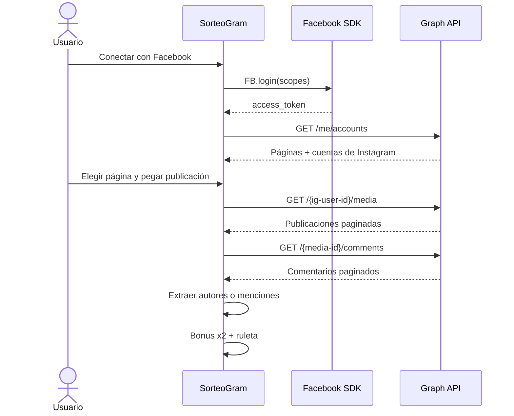

<p align="center">
  
</p>

<h1 align="center">SorteoGram</h1>

<p align="center">
  Sorteos justos y verificables a partir de los comentarios de Instagram.
</p>

<p align="center">
  
  
  
  
  
</p>

---

**SorteoGram** es una aplicación 100% frontend para organizar sorteos de Instagram de forma transparente. Se conecta directamente con Facebook Login y la Graph API oficial de Meta: no hay backend, scraping, cookies de Instagram ni servidores intermedios.

El flujo está pensado para sorteos reales: carga todos los comentarios de una publicación, permite aplicar un bonus x2 a los usuarios que cumplieron una acción extra y elige al ganador con aleatoriedad criptográfica.

## Características

- **Conexión oficial con Meta:** Facebook Login + Graph API desde el navegador.
- **Sin backend:** toda la lógica y el estado viven en el cliente.
- **Comentarios paginados:** recorre todas las páginas disponibles de la publicación.
- **Dos modos de participación:**
  - autores de los comentarios, recomendado para sorteos justos;
  - usuarios mencionados con `@` en el texto.
- **Filtro de duplicados:** una participación por persona o todas las participaciones.
- **Bonus x2:** duplica las entradas de los usuarios seleccionados antes del sorteo.
- **Ruleta animada:** selección con `crypto.getRandomValues`, sin sesgos por orden.
- **Reroll y quema:** vuelve a sortear o elimina al ganador y continúa con el resto.
- **Historial y sesión persistente:** el roster, los bonus, los quemados y el historial se guardan en `localStorage`.
- **Modo demo:** prueba toda la mecánica sin conectar una cuenta de Instagram.
- **Diseño responsive:** interfaz optimizada para escritorio y móvil.

## Cómo funciona



1. El usuario inicia sesión con Facebook y concede los permisos configurados.
2. La app obtiene las páginas administradas y su cuenta de Instagram profesional vinculada.
3. Se extrae el shortcode de la URL y se busca la publicación en el `permalink` de la cuenta.
4. Se recorren todas las páginas de comentarios.
5. Los comentarios se convierten en participantes.
6. Se configura el bonus y se lanza la ruleta.

## Stack

| Capa | Tecnología |
| --- | --- |
| Interfaz | React 19 + TypeScript |
| Build | Vite 8 |
| Estilos | Tailwind CSS 4 |
| Animaciones | Framer Motion |
| Iconos | Lucide React |
| Confeti | canvas-confetti |
| Autenticación | Facebook JS SDK |
| Datos | Meta Graph API |
| Persistencia | localStorage |
| Lint | Oxlint |

## Requisitos

Antes de conectar una cuenta real necesitas:

- Una app creada en Meta for Developers.
- Facebook Login habilitado en la app.
- El dominio donde se sirve la app configurado en Meta.
- Una página de Facebook administrada por el usuario.
- Una cuenta de Instagram profesional o de creador vinculada a esa página.
- Los permisos de Graph API aprobados para leer páginas, publicaciones y comentarios.
- **HTTPS obligatorio.** Facebook Login no funciona desde páginas HTTP.

> El enlace debe pertenecer a la cuenta de Instagram conectada. La Graph API no permite leer comentarios de cualquier cuenta pública ajena.

## Instalación

```bash
npm install
```

Crea el archivo de entorno:

```bash
cp .env.example .env
```

En Windows PowerShell:

```powershell
Copy-Item .env.example .env
```

Edita `.env` y completa el App ID:

```env
VITE_INSTAGRAM_APP_ID=tu_app_id
```

Arranca el entorno de desarrollo:

```bash
npm run dev
```

La app estará disponible en `http://localhost:5173`. En HTTP local la conexión con Facebook permanece deshabilitada; puedes usar el botón de demo. Para probar el login real necesitas servir la aplicación por HTTPS.

## Variables de entorno

| Variable | Obligatoria | Por defecto | Descripción |
| --- | --- | --- | --- |
| `VITE_INSTAGRAM_APP_ID` | Sí | — | App ID público de Meta. |
| `VITE_FB_GRAPH_VERSION` | No | `v23.0` | Versión de la Graph API. |
| `VITE_FB_SCOPES` | No | Ver ejemplo | Permisos solicitados en Facebook Login. |
| `VITE_PARTICIPANT_SOURCE` | No | `authors` | `authors` o `mentions`. |

Ejemplo completo:

```env
VITE_INSTAGRAM_APP_ID=1234567890
VITE_FB_GRAPH_VERSION=v23.0
VITE_FB_SCOPES=public_profile,pages_show_list,pages_read_engagement,instagram_basic,instagram_manage_comments
VITE_PARTICIPANT_SOURCE=authors
```

### Permisos

| Permiso | Uso |
| --- | --- |
| `public_profile` | Perfil básico del usuario que autoriza. |
| `pages_show_list` | Listar las páginas que administra. |
| `pages_read_engagement` | Leer contenido de la página. |
| `instagram_basic` | Acceder a la cuenta de Instagram y sus publicaciones. |
| `instagram_manage_comments` | Leer los comentarios de las publicaciones. |

Los scopes exactos dependen de la configuración y revisión de tu app de Meta. Puedes ajustarlos con `VITE_FB_SCOPES`.

> “Instagram Public Content Access” no es un scope OAuth. Los permisos válidos deben configurarse en la app de Meta y solicitarse mediante Facebook Login.

## Uso

1. Pulsa **Conectar con Facebook** y acepta los permisos.
2. Selecciona la página con la cuenta de Instagram vinculada.
3. Pega la URL de una publicación (`/p/`, `/reel/` o `/tv/`).
4. Elige cómo participar:
   - **Autores:** cuenta a quien escribió el comentario.
   - **Menciones:** cuenta solo a los usuarios etiquetados con `@`.
5. Decide si quieres una participación por persona.
6. Pulsa **Cargar participantes**.
7. Marca el **Bonus x2** para quienes corresponda.
8. Pulsa **Iniciar sorteo**.
9. Usa **Volver a sortear** o **Quemar y sortear** según las reglas de tu sorteo.

### Modo demo

El botón **Probar demo** carga 35 participaciones ficticias de 30 usuarios, incluyendo duplicados para probar el filtro de participación única y la fase de bonus. No requiere conexión con Meta.

## Seguridad y privacidad

- El **App Secret de Meta nunca se usa en el cliente**.
- El token de acceso de Facebook vive únicamente en memoria durante la sesión de la pestaña.
- No se envían datos a servidores propios: las peticiones van directamente a Meta.
- `localStorage` guarda el roster del sorteo, los bonus, los quemados y el historial. No guarda el token.
- La app solo funciona con HTTPS para proteger la sesión de Facebook.
- La selección del ganador usa la Web Crypto API (`crypto.getRandomValues`).

## Estructura del proyecto

```text
.
├── public/
│   └── favicon.svg
├── src/
│   ├── components/
│   │   ├── BonusPhase.tsx
│   │   ├── GraphSetup.tsx
│   │   ├── ParticipantsPanel.tsx
│   │   ├── Roulette.tsx
│   │   └── ...
│   ├── hooks/
│   │   ├── useGraphAPI.ts
│   │   └── useRaffle.ts
│   ├── lib/
│   │   ├── bonus.ts
│   │   ├── config.ts
│   │   ├── demo.ts
│   │   ├── facebook.ts
│   │   ├── graph.ts
│   │   └── random.ts
│   ├── App.tsx
│   ├── main.tsx
│   └── types.ts
├── .env.example
├── index.html
├── package.json
├── tsconfig.json
└── vite.config.ts
```

### Piezas principales

- `src/lib/facebook.ts`: carga del SDK, login, logout y listado de páginas.
- `src/lib/graph.ts`: cliente Graph API, paginación, resolución de publicaciones y extracción de participantes.
- `src/hooks/useGraphAPI.ts`: estado de la conexión con Meta y de la extracción.
- `src/hooks/useRaffle.ts`: estado del sorteo, bonus, historial y persistencia.
- `src/components/GraphSetup.tsx`: interfaz de conexión, selección de página y carga de comentarios.
- `src/components/BonusPhase.tsx`: configuración del bonus x2.
- `src/components/Roulette.tsx`: animación y selección del ganador.

## Scripts

| Comando | Descripción |
| --- | --- |
| `npm run dev` | Inicia Vite en modo desarrollo. |
| `npm run build` | Comprueba TypeScript y genera `dist/`. |
| `npm run preview` | Sirve el build de producción localmente. |
| `npm run lint` | Ejecuta Oxlint. |

## Despliegue

La app es un sitio estático. Genera el build y publica el contenido de `dist/` en cualquier hosting con HTTPS:

```bash
npm run build
```

No se necesita backend ni proxy inverso propio. Configura el dominio de producción en la app de Meta y sirve siempre la aplicación por HTTPS.

## Solución de problemas

| Problema | Causa probable | Solución |
| --- | --- | --- |
| El botón de Facebook no conecta | La app está en HTTP | Sirve la app por HTTPS. |
| No aparecen páginas | Faltan permisos o no administras páginas | Revisa `pages_show_list` y la configuración de Meta. |
| La página no tiene Instagram | No hay cuenta profesional vinculada | Vincula la cuenta desde Meta Business Suite. |
| No encuentra la publicación | La URL no pertenece a esa cuenta | Usa una publicación de la cuenta conectada. |
| Meta devuelve error de permisos | La app no tiene los scopes aprobados | Revisa los permisos y la revisión de la app. |
| No aparecen participantes | No hay comentarios o se eligieron menciones sin `@` | Prueba con “Autores” o revisa la publicación. |
| Meta limita las peticiones | Rate limiting temporal | Espera unos minutos y vuelve a intentarlo. |

## Límites conocidos

- La búsqueda de la publicación recorre hasta 30 páginas de media (3.000 publicaciones) para encontrar el shortcode.
- La extracción de comentarios admite hasta 200 páginas de 100 comentarios (20.000 comentarios) por seguridad.
- Se leen comentarios de primer nivel; las respuestas anidadas no se incluyen.
- La Graph API solo expone cuentas profesionales vinculadas a una página que administre el usuario autenticado.

---

<p align="center">
  Hecho con React, Facebook Login y Meta Graph API.
</p>
